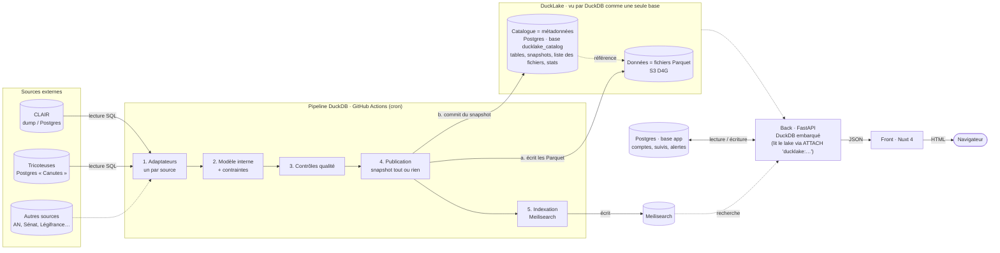

# 1. Flux de données

[← Sommaire](README.md) · [Déploiement →](02-deploiement.md)

**Ce qu'il faut retenir**

- La pipeline est la **seule** à écrire dans le DuckLake et dans Meilisearch.
- Les sources ne sont lues **que par leur adaptateur**. Ajouter une source revient à ajouter un adaptateur. Tout ce qui vient après (contrôles, API, front)
  ne connaît que le **modèle interne**.
- L'API **lit** le lake et Meili. Elle ne lit et n'écrit que dans la base `app` (les utilisateurs).
- Le front ne parle **qu'à l'API**.



## Comment fonctionne le DuckLake

Un DuckLake se compose de deux morceaux, que **seul DuckDB manipule** : ni l'API ni la pipeline
ne lisent les tables du catalogue elles-mêmes.

- **Les données** : des fichiers Parquet sur S3. Ils ne sont jamais modifiés : un changement crée de nouveaux fichiers.
- **Le catalogue** : une base Postgres ordinaire, gérée par l'extension `ducklake`. Elle indique quelles
  tables existent, avec quelles colonnes, quels fichiers Parquet composent chaque table à chaque
  snapshot, et des statistiques (min/max par colonne) pour éviter de lire des fichiers inutiles.

Côté code, on attache le lake comme une seule base, puis on écrit du SQL normal :

```sql
ATTACH 'ducklake:postgres:dbname=ducklake_catalog host=…' AS lake (DATA_PATH 's3://…/');
SELECT * FROM lake.amendements WHERE …;
```

**En lecture** (l'API), DuckDB demande au catalogue la liste des fichiers du snapshot courant,
écarte ceux que les statistiques excluent, puis lit **directement** les Parquet utiles sur S3.

**En écriture** (la pipeline), DuckDB écrit d'abord les nouveaux Parquet sur S3, puis enregistre dans
le catalogue, en **une seule transaction Postgres**, le nouveau snapshot qui les référence. Tant que cette
transaction n'a pas abouti, les nouveaux fichiers sont invisibles. C'est ce qui donne la publication
« tout ou rien » et le retour arrière (on relit un snapshot précédent).

Conséquence pratique : un processus qui lit le lake a besoin **des deux accès**, au Postgres du
catalogue et au S3 (en lecture seule pour l'API, en écriture pour la pipeline).
