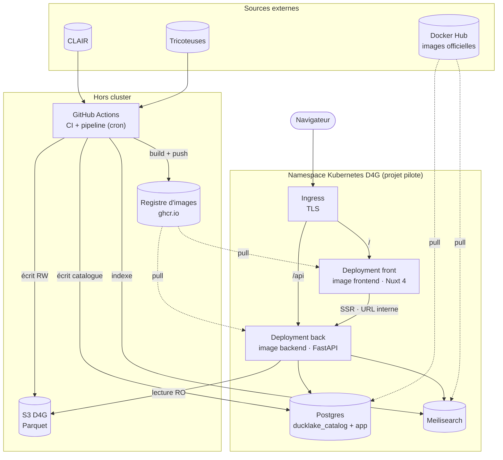

# 2. Déploiement

[← Flux de données](01-flux-donnees.md) · [Sommaire](README.md) · [Requête utilisateur →](03-requete-utilisateur.md)

**Ce qu'il faut retenir**

- On produit **deux images Docker** : `backend` (FastAPI) et `frontend` (Nuxt).
- Postgres et Meilisearch tournent **dans notre namespace**.
- La pipeline **ne tourne pas dans le cluster** : c'est une GitHub Action planifiée

