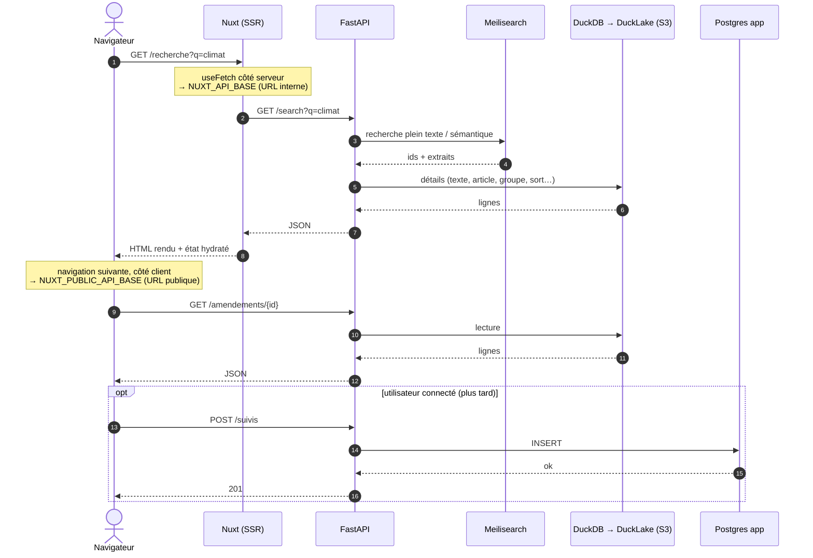

# 3. Une requête utilisateur

[← Déploiement](02-deploiement.md) · [Sommaire](README.md) · [Structure du repo →](04-structure-repo.md)

**Ce qu'il faut retenir**

- **L'API, c'est le back FastAPI.** Il n'y a pas de couche en plus : le front appelle ses routes en HTTP et
  reçoit du JSON. « L'URL de l'API », c'est donc l'URL de FastAPI.
- Le **contrat** entre front et back est la description OpenAPI que FastAPI génère tout seul (page `/docs`).
- Nuxt appelle FastAPI depuis **deux endroits**, donc avec deux URL fournies par variables d'environnement
  via `runtimeConfig` :
  - **côté serveur** (rendu SSR de la première page) : `NUXT_API_BASE`, l'URL **interne** au cluster ;
  - **côté navigateur** (navigation, recherche au fil de la frappe) : `NUXT_PUBLIC_API_BASE`, l'URL **publique**.
- Ces URL ne sont **jamais en dur** dans le code : la même image tourne en local, en dev et en prod.

